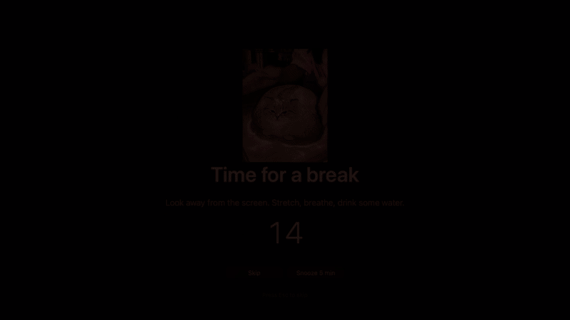

# Stray Cat

A tiny macOS menu bar app. A stray cat pops up in a corner of your screen every now and then, and once an
hour it nudges you to take a screen break: a 15-second heads-up card, then a dimmed full-screen break
with a countdown.

- **Pop-up cat** that peeks in from a bottom corner at random times. Use the drawn cat (random coat each
  time) or your own pictures and GIFs.
- **Break reminder** every hour (configurable): warning card with Skip / Snooze / Start now, then a dimmed
  screen over everything, including full-screen apps.
- **Break screen picture:** your own images, or a random GIF from a Tenor search page (default
  `https://tenor.com/search/aura-gifs`, or type any words).
- **Stays out of the way while you screen-share:** no cat and no dimming during a detected Zoom share or
  while the microphone is in use.
- Start at login, all timings adjustable from the settings window.

## See it in action

<table>
  <tr><th>Pop-up cat</th><th>Break screen</th></tr>
  <tr>
    <td></td>
    <td></td>
  </tr>
</table>

## Install

**One-line install (recommended)**, which avoids macOS's "damaged" warning:

```sh
curl -fsSL https://raw.githubusercontent.com/denniwang/stray-cat-widget/main/install.sh | bash
```

**Homebrew:**

```sh
brew tap denniwang/stray-cat-widget https://github.com/denniwang/stray-cat-widget
brew install --cask denniwang/stray-cat-widget/straycat
```

**Manual download:** get `StrayCat.zip` from the [latest release](../../releases/latest), unzip it, and drag
`StrayCat.app` to `/Applications`. The app isn't notarized, so a browser download is blocked with a message
like "StrayCat is damaged and can't be opened" or "Apple could not verify…". Clear the flag and open it again:

```sh
xattr -dr com.apple.quarantine /Applications/StrayCat.app
```

On recent macOS you can instead open **System Settings → Privacy & Security** and click **Open Anyway**.

Requires macOS 13 or later. Runs on Apple Silicon and Intel.

## Using it

Look for the 🐈 in the menu bar: its menu has Settings, the break countdown, and "Call the cat". Launching the
app a second time also opens Settings.

## Build from source

```sh
./build.sh          # builds build/StrayCat.app and build/StrayCat.zip
open build/StrayCat.app
```

Needs the Xcode command line tools (`xcode-select --install`). The whole app is one file,
`Sources/main.swift`, with no dependencies.

## Limitations

- **Screen-share detection is best-effort.** macOS has no public API for it. The app detects Zoom's share
  helper and any app using the microphone. Other shares (muted Meet/Teams, recordings, AirPlay) are not
  detected. The cat and dim windows are also marked as excluded from screen capture, which apps using
  ScreenCaptureKit should respect.
- **Tenor GIFs** come from reading the HTML of a Tenor search page, because Tenor no longer issues API keys.
  It can break if Tenor changes its site. Your own images are always the fallback.
- The dimming is a dark overlay, not a change to display brightness, and it does not block keyboard shortcuts.

## License

MIT
